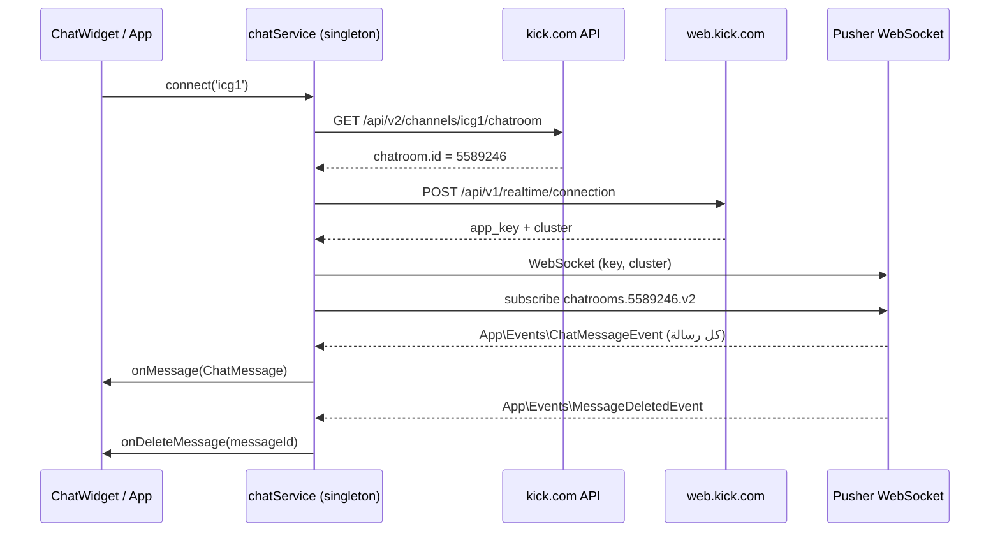

# دليل استخراج شات قناة Kick — مشروع iCG1

> هذا الملف **توثيقي فقط**. لم يتم تعديل أي كود أو إعداد داخل المشروع.
> كل ما يلي يشرح كيف يعمل استخراج الشات الموجود حالياً، وأين توجد كل قطعة منه، وكيف تعيد تنفيذه بنفسك.

---

## 0) الخلاصة السريعة

استخراج الشات في هذا المشروع يعتمد على **WebSocket مباشر من Kick عبر Pusher**، وليس على قراءة الصفحة (DOM) ولا على API تاريخي.

الرحلة الكاملة:

1. تحويل اسم القناة (`icg1`) إلى **رقم غرفة الشات** (`chatroomId`).
2. جلب **بيانات اعتماد Pusher** الحالية من Kick (المفتاح + الـ cluster).
3. فتح اتصال WebSocket والاشتراك في القناة `chatrooms.{chatroomId}.v2`.
4. الاستماع لحدث `App\Events\ChatMessageEvent` واستلام كل رسالة لحظة وصولها.
5. تحويل الرسالة إلى الشكل الداخلي `ChatMessage` وعرضها أو تمريرها للألعاب.
6. متابعة حدث حذف الرسائل `App\Events\MessageDeletedEvent`.
7. إعادة الاتصال تلقائياً عند الانقطاع أو تغيّر مفتاح Pusher.

نقطة مهمة جداً:

> **هذا الاستخراج مباشر (Live فقط).** لا يجلب الرسائل القديمة، ولا يوجد في الكود أي طلب لجلب أرشيف الشات. أي رسالة أُرسلت قبل لحظة الاتصال لن تظهر. إذا أردت أرشيفاً كاملاً فيجب تشغيل مسجّل (Logger) يعمل 24/7 من الآن فصاعداً، أو الاعتماد على أرشيف طرف ثالث.

---

## 1) الملفات المسؤولة

| الملف | الدور |
|---|---|
| `services/chatService.ts` | العقل الكامل: تحديد الغرفة، بيانات Pusher، الاتصال، الأحداث، الحذف، الصور، الإرسال، إعادة الاتصال |
| `components/ChatWidget.tsx` | واجهة الشات: العرض، الفلاتر، الشارات، الإيموتات، عداد الرسائل، المخزن المؤقت |
| `components/ChatWidget.css` | تنسيق واجهة الشات |
| `App.tsx` | يشغّل الاتصال العام بالقناة `icg1` عند فتح التطبيق |
| `components/Layout.tsx` | يضع `<ChatWidget />` داخل الشريط الجانبي |
| `types.ts` | تعريف `ChatMessage` و`ChatUser` و`ChatBadge` |
| `utils/assets.ts` | فحص انتهاء صلاحية روابط صور Kick الموقّعة |
| `vite.config.ts` | بروكسي التطوير `/kick-api` إلى `https://api.kick.com` |
| `api/auth/chat-verify-issue.ts` | إصدار كود تحقق للمستخدم (آلية منفصلة عن قراءة الشات) |
| `api/auth/chat-verify.ts` | التحقق من الكود المُدخل في الموقع |
| `components/BotDashboard.tsx` | لوحة ربط بوت خارجي عبر خادم منفصل (اختياري) |

---

## 2) المخطط العام



تدفق البيانات داخلياً:

```text
Kick Pusher Event
      ↓
chatService.bind(...)
      ↓
تحويل الحقول إلى ChatMessage
      ↓
listeners (كل مكوّن سجّل onMessage)
      ↓
ChatWidget يعرض + الألعاب تقرأ الأوامر والأرقام
```

---

## 3) الخطوة الأولى: تحديد القناة ورقم غرفة الشات

### 3.1 اسم القناة (Slug)

الكود يوحّد الاسم إلى حروف صغيرة ويحذف الفراغات:

```ts
const slug = channelSlug.toLowerCase().trim();
```

القنوات المستخدمة فعلياً في المشروع:

| القناة | من يستخدمها |
|---|---|
| `icg1` | `App.tsx` و`ChatWidget.tsx` و`EmojiCode` و`GlobalPasswordPage` |
| `iabs` | `AboutPage` و`AdminDashboard` و`GlobalPasswordPage` |
| `xeid` | موجودة في جدول الغرف المعروفة فقط |

### 3.2 جدول الغرف المعروفة (الاختصار الأول)

داخل `services/chatService.ts` يوجد جدول ثابت:

```ts
private KNOWN_CHATROOM_IDS: Record<string, number> = {
  'icg1': 5589246,
  'iabs': 1060205,
  'xeid': 47582,
};
```

إذا كانت القناة موجودة هنا، يُرجع الرقم فوراً **بدون أي طلب شبكة**. هذا أسرع مسار، لكنه يعني أن الرقم لو تغيّر من جهة Kick سيبقى قديماً حتى يُحدَّث يدوياً.

### 3.3 الطلب المباشر من Kick (المسار الأساسي)

إذا لم تكن القناة في الجدول، يجرّب `fetchChatroomIdFromKick()` بالترتيب:

```text
1) GET https://kick.com/api/v2/channels/{slug}/chatroom
   → يقرأ data.id أو data.chatroom.id

2) GET https://kick.com/api/v2/channels/{slug}
   → يقرأ data.chatroom.id فقط
```

الكود يعتبر أن Kick يسمح بالقراءة عبر CORS من المتصفح، لذلك يبدأ بالطلب المباشر قبل أي وسيط. هذه الميزة قد تتغير من جهة Kick في أي وقت.

مثال يدوي:

```bash
curl -s "https://kick.com/api/v2/channels/icg1/chatroom" \
  -H "Accept: application/json" \
  -H "User-Agent: Mozilla/5.0" | jq '.id // .chatroom.id'
```

### 3.4 الذاكرة المحلية (localStorage)

كل رقم يُكتشف بنجاح يُحفظ تحت المفتاح:

```text
kick_chatroom_id_{slug}
```

مثال: `kick_chatroom_id_icg1`.

عند فشل الطلب المباشر، يُقرأ الرقم المحفوظ. وإذا كان الرقم غير صالح أو غير موجود، ينتقل للوسطاء.

### 3.5 الوسطاء (CORS Proxies)

آخر محاولة قبل الفشل، وتعمل الثلاثة بالتوازي (`Promise.allSettled`) بمهلة 5 ثوانٍ لكل واحد:

```text
https://api.allorigins.win/raw?url={encodedKickUrl}
https://corsproxy.io/?{encodedKickUrl}
https://api.codetabs.com/v1/proxy/quest={encodedKickUrl}
```

رد `allorigins` يكون داخل `contents`، لذلك يوجد `parseProxyResponse()` يفكّه إلى JSON.

إذا فشل كل شيء:

```text
Error: لم يتم العثور على القناة: {slug}
```

### 3.6 ماذا يعني رقم الغرفة؟

هو معرف داخلي لغرفة الشات في Kick، ويُستخدم في:

- اسم قناة Pusher: `chatrooms.{chatroomId}.v2`
- إرسال الرسائل: `POST /public/v1/chatrooms/{chatroomId}/messages`

---

## 4) الخطوة الثانية: بيانات اعتماد Pusher

Kick لا يعطي مفتاح Pusher ثابتاً للأبد؛ المفتاح قد يتغير. لذلك الكود يجلبه ديناميكياً.

### 4.1 طلب البيانات الحالية

```http
POST https://web.kick.com/api/v1/realtime/connection
Content-Type: application/json
Accept: application/json
x-app-platform: web

{
  "client": { "id": "<uuid>", "type": "web" },
  "capabilities": {
    "accepted_providers": [{ "provider": "pusher" }]
  }
}
```

الاستجابة المطلوبة:

```json
{
  "data": {
    "connections": [
      {
        "provider": "pusher",
        "credentials": {
          "app_key": "....",
          "cluster": "us2"
        }
      }
    ]
  }
}
```

الكود يبحث عن أول اتصال نوعه `pusher` ويأخذ `app_key` و`cluster`.

### 4.2 الكاش

البيانات تُحفظ في `localStorage` تحت:

```text
kick_pusher_credentials
```

مع طابع زمني `ts`، ومدة صلاحية **6 ساعات**. بعدها يُعاد الجلب.

### 4.3 البديل الاحتياطي

إذا فشل الجلب، يستخدم:

```ts
PUSHER_FALLBACK = { key: '34bf7a0ff419a2a775b9', cluster: 'us2' }
```

> هذا مفتاح احتياطي عام وليس سراً، لكنه قابل للتغيير من Kick. إذا توقف الشات فجأة، أول شيء تفحصه هو هذا المفتاح.

### 4.4 عند رفض بيانات الاعتماد

إذا أرسل Pusher خطأ بالكود `4001` أو `4000`:

1. يُمسح `pusherCredentials` من الذاكرة.
2. يُحذف `kick_pusher_credentials` من `localStorage`.
3. تُجدول إعادة محاولة، وعندها يُجلب مفتاح جديد من Kick.

---

## 5) الخطوة الثالثة: فتح الاتصال والاشتراك

بعد الحصول على الرقم والبيانات:

```ts
const PusherClient = (Pusher as any).default || Pusher;

this.pusher = new PusherClient(credentials.key, {
  cluster: credentials.cluster,
  forceTLS: true,
  enabledTransports: ['ws', 'wss'],
  disabledTransports: ['xhr_polling', 'xhr_streaming'],
  statsTimeout: 0,
  pongTimeout: 30000,
  wsTimeout: 30000,
  maxRetries: 9999,
  loopBackTimer: 2000
});

this.channel = this.pusher.subscribe(`chatrooms.${chatroomId}.v2`);
```

### 5.1 لماذا WebSocket فقط؟

الكود يعطّل `xhr_polling` و`xhr_streaming` ويسمح فقط بـ `ws` و`wss`. الهدف: اتصال حقيقي مستمر وأسرع، بدون polling.

### 5.2 القناة الصحيحة

اسم القناة حساس:

```text
chatrooms.{chatroomId}.v2
```

مثال:

```text
chatrooms.5589246.v2
```

لو استخدمت `chatrooms.5589246` بدون `.v2` فلن تصلك الرسائل.

### 5.3 قيد مهم: الاتصال واحد فقط

`chatService` كائن مفرد (Singleton) ويملك اتصال Pusher واحداً. عند استدعاء `connect()` بقناة مختلفة:

- يتم تنظيف الاتصال السابق بالكامل (`cleanupPusher`).
- يُفتح اتصال جديد للقناة الأخيرة.

لذلك في `GlobalPasswordPage` عند استدعاء:

```ts
chatService.connect('icg1');
chatService.connect('iabs');
```

الاتصال النهائي سيكون لـ `iabs` فقط. هذه ليست قراءة متوازية لقناتين.

---

## 6) الخطوة الرابعة: الأحداث التي يجب الاشتراك فيها

### 6.1 حدث الرسالة

```ts
this.channel.bind('App\\Events\\ChatMessageEvent', (data) => { ... });
```

الشكل الفعلي للبيانات كما يتعامل معه الكود:

```json
{
  "id": "abc123",
  "content": "نص الرسالة [emote:12345:name]",
  "sender": {
    "id": "39763938",
    "username": "HSG2",
    "identity": {
      "color": "#31d6d6",
      "badges": [
        { "type": "broadcaster", "text": "" },
        { "type": "subscriber", "text": "3" }
      ]
    },
    "profilepic": "https://...",
    "profile_pic": "https://...",
    "avatar_url": "https://..."
  }
}
```

الحقول المستخدمة:

| حقل Kick | الاستخدام |
|---|---|
| `data.id` | معرف الرسالة، وللتفريق بينها ومنع التكرار |
| `data.content` | نص الرسالة الخام |
| `data.sender.id` | معرف المستخدم |
| `data.sender.username` | اسم المستخدم |
| `data.sender.identity.color` | لون الاسم |
| `data.sender.identity.badges[]` | الشارات والأدوار |
| `data.sender` كامل | محاولة استخراج صورة البروفايل |

> ملاحظة دقيقة: الكود يضع `timestamp: Date.now()` أي **وقت وصول الرسالة إلى المتصفح**، وليس وقت إرسالها من Kick. أي حقل وقت قادم من Kick لا يُستخدم حالياً.

### 6.2 حدث حذف الرسالة

```ts
this.channel.bind('App\\Events\\MessageDeletedEvent', (data) => {
  const messageId = data.message?.id;
  if (messageId) {
    this.deleteListeners.forEach(cb => cb(messageId));
  }
});
```

الرسالة لا تُحذف من المصفوفة، بل تُعلَّم:

```ts
{ ...m, deleted: true }
```

وتظهر في الواجهة كنص:

```text
تم حذف هذه الرسالة بواسطة الإدارة
```

### 6.3 أحداث حالة الاتصال

| الحدث | المعنى |
|---|---|
| `connected` | تم الاتصال، يتم إيقاف مؤقت المهلة وتشغيل فحص الصحة |
| `error` | خطأ، وربما رفض مفتاح (4001/4000) |
| `disconnected` | انقطاع، مع جدولة إعادة اتصال |
| `state_change` | مراقبة الانتقال إلى `disconnected` أو `failed` |

عند النجاح تُبث الحالة:

```text
متصل (ID: {chatroomId})
```

وهي التي تجعل رأس الواجهة يعرض:

```text
القناة متصلة
```

---

## 7) الخطوة الخامسة: تحويل الرسالة إلى `ChatMessage`

الشكل الداخلي في `types.ts`:

```ts
export interface ChatMessage {
  id: string;
  user: ChatUser;
  content: string;
  role: 'owner' | 'moderator' | 'vip' | 'subscriber' | 'founder' | 'gifter' | 'user';
  badges?: ChatBadge[];
  timestamp: number;
  deleted?: boolean;
}

export interface ChatUser {
  id: string;
  username: string;
  color?: string;
  avatar?: string;
  isBot?: boolean;
  role?: 'owner' | 'moderator' | 'vip' | 'subscriber' | 'founder' | 'gifter' | 'user';
  badges?: ChatBadge[];
}
```

التحويل:

```ts
const role = getRoleFromIdentity(data.sender?.identity);
const badges = mapBadges(data.sender?.identity);

const message: ChatMessage = {
  id: data.id || Math.random().toString(36).substr(2, 9),
  user: {
    id: data.sender?.id || '0',
    username: data.sender?.username || 'Unknown',
    color: data.sender?.identity?.color || '#31d6d6',
    avatar: this.pickAvatarFromKickData(data.sender) || '',
    role,
    badges
  },
  content: data.content || '',
  role,
  badges,
  timestamp: Date.now()
};
```

### 7.1 ترتيب الأدوار

الدور يُحسب بأول شارة مطابقة حسب هذا الترتيب:

```text
broadcaster → owner
moderator   → moderator
founder     → founder
vip         → vip
sub_gifter  → gifter
subscriber  → subscriber
غير ذلك     → user
```

لاحظ:

- `broadcaster` يعني صاحب القناة ويُعرض `owner`.
- `sub_gifter` يُعرض `gifter`.
- `og` و`verified` قد تظهر كشارات في الواجهة لكنهما ليسا ضمن حساب `role`.
- شارة `bot` لا تدخل في حساب الدور؛ الواجهة تكشف البوت باسم `botrix` أو شارة `bot`.

### 7.2 ترتيب عرض الشارات في الواجهة

```text
broadcaster, moderator, vip, og, founder, subscriber, sub_gifter, verified
```

مع معالجة خاصة لشارة:

```text
bot
```

---

## 8) الخطوة السادسة: صور المستخدمين

### 8.1 المصدر الأساسي

```text
GET https://kick.com/api/v1/users/{username}
```

يُستخرج الرابط من أول حقل صالح:

```text
profilepic
profile_pic
profile_pic_url
profilePic
avatar.url
avatar_url
user.profilepic
user.profile_pic
...
```

وإذا لم يوجد، يبحث عن أي قيمة نصية تبدو رابط صورة.

### 8.2 التطبيع

- `//host/...` → `https://host/...`
- `/path/...` → `https://kick.com/path/...`
- رابط بدون بروتوكول → `https://kick.com/...`

### 8.3 الوسطاء

بعد المحاولة المباشرة، يجرّب بالترتيب/بالتوازي:

```text
/api/kick?endpoint={encodedKickUserApi}
https://api.allorigins.win/raw?url={encodedKickUserApi}&disableCache=true
https://corsproxy.io/?{encodedKickUserApi}
https://api.codetabs.com/v1/proxy?quest={encodedKickUserApi}
... ثم مسار القناة /api/v1/channels/{slug}
```

> `/api/kick?endpoint=...` مذكور في الكود كمسار داخلي، لكنه غير موجود كملف API داخل مجلد `api/` في هذه النسخة. عملياً يعتمد الكود على كيك المباشر ثم الوسطاء.

### 8.4 مشكلة انتهاء صلاحية الصور

صور Kick غالباً روابط S3 موقّعة تحتوي:

```text
X-Amz-Date=...
X-Amz-Expires=...
```

وتنتهي صلاحيتها بعد دقائق. لذلك:

- تُفحص عبر `isExpiredSignedUrl()` في `utils/assets.ts`.
- تُحفظ في الذاكرة و`localStorage` تحت `kick_av_{slug}`.
- الرابط المنتهي لا يُستخدم، بل يُجلب رابط جديد.

---

## 9) الخطوة السابعة: الصلابة وإعادة الاتصال

الاستخراج مصمم ليبقى حياً لساعات، لذلك فيه عدة طبقات:

### 9.1 حراسة الاتصال

- `connectionId` يتزايد مع كل محاولة، وأي callback من محاولة قديمة يُتجاهل.
- `isConnecting` يمنع حالة التعليق.
- مؤقت أمان **15 ثانية**: إذا لم يكتمل الاتصال، تُعاد المحاولة.

### 9.2 إعادة الاتصال التلقائي

```text
delay = min(1500 × 1.5^(attempt-1), 15000)
```

أي تبدأ من 1.5 ثانية وتصاعدياً حتى سقف 15 ثانية، مع `maxReconnectAttempts = 9999`.

### 9.3 فحص الصحة

كل **10 ثوانٍ**:

```text
إذا pusher.connection.state !== 'connected'
→ تنظيف + إعادة اتصال
```

ملاحظة: يوجد حقل `lastMessageTime` يُحدَّث مع كل رسالة، لكنه **لا يُستخدم حالياً** لكشف صمت الشات. الفحص يعتمد على حالة الاتصال فقط.

### 9.4 سلوك الإيقاف

`disconnect()`:

- يوقف إعادة الاتصال.
- يوقف فحص الصحة.
- يلغي المؤقتات.
- ينظّف Pusher والقناة.
- يصفّر `currentChatroomId` و`currentChannelSlug`.

---

## 10) الخطوة الثامنة: من يستقبل الرسائل داخل المشروع؟

### 10.1 التشغيل العام

في `App.tsx`:

```ts
useEffect(() => {
  const channel = 'icg1';
  chatService.connect(channel);
}, []);
```

أي أن الاتصال يبدأ بمجرد فتح التطبيق، ويبقى حياً حتى مع تغيير الصفحات.

### 10.2 الواجهة

في `components/Layout.tsx`:

```tsx
<ChatWidget lang="ar" />
```

### 10.3 الألعاب

كل الألعاب تقريباً تشترك بنفس الطريقة:

```ts
const unsub = chatService.onMessage((msg) => {
  // قراءة "دخول" أو رقم أو أمر
});

return unsub;
```

أمثلة موجودة في:

- `FlagQuiz`
- `BlurGuess`
- `FawazirGame`
- `BossRaid`
- `CupShuffle`
- `DrawingChallenge`
- `FloorIsLava`
- `ForbiddenWords`
- `FruitWar`
- `GlassBridge`
- `GlassBridgeV2`
- `EmojiCode`
- وغيرها

هذه هي أهمية الاستخراج: الشات هو قناة الإدخال الأساسية للاعبين.

### 10.4 المخزن المؤقت في الواجهة

- كل رسالة تُضاف إلى الحالة.
- يُمنع التكرار بمقارنة `id`.
- الحد الأقصى **150 رسالة** في الذاكرة، ثم تُحذف الأقدم.
- لا يوجد حفظ دائم: تحديث الصفحة يمسح كل شيء.

```ts
const next = [...prev, msg];
return next.length > 150 ? next.slice(-150) : next;
```

---

## 11) ماذا تعرض الواجهة بالتفصيل؟

كل هذا داخل `components/ChatWidget.tsx`:

### 11.1 الفلاتر

| الزر | يعرض |
|---|---|
| الكل | كل الرسائل |
| المشتركين | `subscriber` أو `founder` أو `sub_gifter` |
| المشرفين | `moderator` |
| VIP | `vip` |
| OG | `og` |

### 11.2 تنسيق اسم المستخدم

إذا كان اللون غير صالح أو غير موجود، يُختار لون من لوحة ثابتة بناءً على مجموع أحرف الاسم. ثم إذا كان اللون داكناً جداً يُفتَّح تلقائياً ليبقى مقروءاً.

### 11.3 تحليل نص الرسالة

الترتيب:

1. إذا كان النص `دخول` بالضبط → شارة انضمام.
2. إذا كان النص رقماً من 1 إلى 3 خانات → شارة رقم.
   - تُحوَّل الأرقام العربية `٠١٢٣٤٥٦٧٨٩` إلى `0123456789` أولاً.
3. غير ذلك يُطبَّق التعبير النمطي:

```regex
\[emote:(\d+):([^\]]+)\]|(https?:\/\/[^\s]+)|(@[\w\u0600-\u06FF]+)|(![\w\u0600-\u06FF]+)
```

ويهدف إلى:

| النمط | العرض |
|---|---|
| `[emote:ID:name]` | صورة إيموت من `https://files.kick.com/emotes/{ID}/fullsize` |
| `https://...` | رابط يعرض اسم النطاق فقط ويفتح في تبويب جديد |
| `@اسم` | منشن |
| `!أمر` | أمر |

إذا فشل تحميل الإيموت، يُستبدل بنص `:name:`.

### 11.4 عداد الرسائل

- يحتفظ بأوقات آخر الرسائل.
- كل 1.5 ثانية يحسب كم رسالة وصلت خلال آخر 60 ثانية.
- يعرضها كـ `رسالة/د`.

### 11.5 أدوات إضافية

- زر إعادة الاتصال.
- تعديل حجم الخط بين 12 و24.
- إيقاف/استئناف التمرير التلقائي.
- عدّاد رسائل جديدة عند التمرير للأعلى.
- مسح الشات من الذاكرة.
- حالة الاتصال في الرأس: متصل / غير متصل / جاري الاتصال.

---

## 12) إعادة التنفيذ بنفسك

### 12.1 من داخل صفحة Kick (أسهل طريقة لتجاوز CORS)

افتح صفحة القناة على `kick.com`، ثم Console والصق:

```js
(async () => {
  const slug = 'icg1';
  const KNOWN = { icg1: 5589246, iabs: 1060205, xeid: 47582 };

  let chatroomId = KNOWN[slug] || null;

  if (!chatroomId) {
    const r = await fetch(`https://kick.com/api/v2/channels/${slug}/chatroom`, {
      headers: { Accept: 'application/json' }
    });
    const j = await r.json();
    chatroomId = j?.id || j?.chatroom?.id;
  }

  if (!chatroomId) throw new Error('chatroomId not found');

  let creds = { key: '34bf7a0ff419a2a775b9', cluster: 'us2' };

  try {
    const res = await fetch('https://web.kick.com/api/v1/realtime/connection', {
      method: 'POST',
      headers: {
        'Content-Type': 'application/json',
        Accept: 'application/json',
        'x-app-platform': 'web'
      },
      body: JSON.stringify({
        client: { id: crypto.randomUUID(), type: 'web' },
        capabilities: { accepted_providers: [{ provider: 'pusher' }] }
      })
    });
    const j = await res.json();
    const c = j?.data?.connections?.find((x) => x.provider === 'pusher')?.credentials;
    if (c?.app_key) creds = { key: c.app_key, cluster: c.cluster };
  } catch (e) {
    console.warn('Pusher credentials fallback', e);
  }

  await new Promise((resolve, reject) => {
    if (window.Pusher) return resolve();
    const s = document.createElement('script');
    s.src = 'https://js.pusher.com/8.4.0/pusher.min.js';
    s.onload = resolve;
    s.onerror = reject;
    document.head.appendChild(s);
  });

  const pusher = new Pusher(creds.key, {
    cluster: creds.cluster,
    forceTLS: true,
    enabledTransports: ['ws', 'wss']
  });

  const channel = pusher.subscribe(`chatrooms.${chatroomId}.v2`);

  channel.bind('App\\Events\\ChatMessageEvent', (data) => {
    console.log('[CHAT]', {
      id: data.id,
      user: data.sender?.username,
      content: data.content,
      badges: data.sender?.identity?.badges
    });
  });

  channel.bind('App\\Events\\MessageDeletedEvent', (data) => {
    console.log('[DELETED]', data.message?.id);
  });

  pusher.connection.bind('connected', () => {
    console.log('[CONNECTED]', chatroomId);
  });

  window.__kickChat = { pusher, channel, chatroomId };
})();
```

بعدها:

```js
// إيقاف
window.__kickChat.pusher.disconnect();
```

### 12.2 سكربت Node.js لتسجيل الشات في ملف

يحتاج Node 18+ (يفضَّل 22+ لوجود `WebSocket` عام)، والمشروع يحتوي `pusher-js` مسبقاً.

أنشئ الملف **خارج** المشروع أو في أي مجلد مؤقت:

```js
// scrape-chat.mjs
import fs from 'node:fs';
import Pusher from 'pusher-js';

const SLUG = process.argv[2] || 'icg1';
const KNOWN = { icg1: 5589246, iabs: 1060205, xeid: 47582 };
const OUT = `chat-${SLUG}-${new Date().toISOString().replace(/[:.]/g, '-')}.jsonl`;

if (!globalThis.WebSocket) {
  globalThis.WebSocket = (await import('ws')).default;
}

async function getChatroomId() {
  if (KNOWN[SLUG]) return KNOWN[SLUG];

  const r = await fetch(`https://kick.com/api/v2/channels/${SLUG}/chatroom`, {
    headers: { Accept: 'application/json' }
  });
  if (!r.ok) throw new Error(`chatroom lookup failed: ${r.status}`);

  const j = await r.json();
  const id = j?.id || j?.chatroom?.id;
  if (!id) throw new Error('chatroom id not found');
  return id;
}

async function getCredentials() {
  try {
    const res = await fetch('https://web.kick.com/api/v1/realtime/connection', {
      method: 'POST',
      headers: {
        'Content-Type': 'application/json',
        Accept: 'application/json',
        'x-app-platform': 'web'
      },
      body: JSON.stringify({
        client: { id: crypto.randomUUID(), type: 'web' },
        capabilities: { accepted_providers: [{ provider: 'pusher' }] }
      })
    });
    const j = await res.json();
    const c = j?.data?.connections?.find((x) => x.provider === 'pusher')?.credentials;
    if (c?.app_key) return { key: c.app_key, cluster: c.cluster };
  } catch (e) {
    console.warn('credentials fetch failed:', e.message);
  }
  return { key: '34bf7a0ff419a2a775b9', cluster: 'us2' };
}

const chatroomId = await getChatroomId();
const creds = await getCredentials();

console.log(`[iCG1] channel=${SLUG} chatroom=${chatroomId} cluster=${creds.cluster}`);
console.log(`[iCG1] writing to ${OUT}`);

const pusher = new Pusher(creds.key, {
  cluster: creds.cluster,
  forceTLS: true,
  enabledTransports: ['ws', 'wss']
});

const channel = pusher.subscribe(`chatrooms.${chatroomId}.v2`);

channel.bind('App\\Events\\ChatMessageEvent', (data) => {
  const record = {
    type: 'message',
    receivedAt: new Date().toISOString(),
    id: data.id ?? null,
    userId: data.sender?.id ?? null,
    username: data.sender?.username ?? null,
    color: data.sender?.identity?.color ?? null,
    badges: (data.sender?.identity?.badges || []).map((b) => ({
      type: b.type,
      text: b.text
    })),
    content: data.content ?? '',
    raw: data
  };

  fs.appendFileSync(OUT, JSON.stringify(record) + '\n');
  console.log(`[MSG] ${record.username}: ${record.content}`);
});

channel.bind('App\\Events\\MessageDeletedEvent', (data) => {
  const record = {
    type: 'deleted',
    receivedAt: new Date().toISOString(),
    messageId: data.message?.id ?? null,
    raw: data
  };

  fs.appendFileSync(OUT, JSON.stringify(record) + '\n');
  console.log(`[DEL] ${record.messageId}`);
});

pusher.connection.bind('connected', () => {
  console.log(`[CONNECTED] ${chatroomId}`);
});

pusher.connection.bind('error', (err) => {
  console.error('[PUSHER ERROR]', err?.error?.data?.code, err?.error?.data?.message);
});

pusher.connection.bind('disconnected', () => {
  console.warn('[DISCONNECTED]');
});

process.on('SIGINT', () => {
  console.log('\nbye');
  pusher.disconnect();
  process.exit(0);
});
```

التشغيل:

```bash
node scrape-chat.mjs icg1
```

كل سطر في ملف `chat-*.jsonl` هو رسالة JSON مستقلة. هذا هو الشكل الأنسب للأرشفة لأنه:

- لا يفقد السطور السابقة عند الانقطاع.
- سهل المعالجة بـ `jq` أو Python.
- يحتفظ بالبيانات الخام `raw` كاملة.

مثال قراءة:

```bash
jq -r 'select(.type=="message") | "\(.receivedAt) \(.username): \(.content)"' chat-icg1-*.jsonl | tail -50
```

### 12.3 ماذا لو احتجت 24/7؟

شغّل السكربت تحت مدير عمليات:

- `pm2 start scrape-chat.mjs --name icg1-chat -- icg1`
- أو `systemd`
- أو داخل حاوية Docker مع `restart: always`

المهم:

- أعد المحاولة تلقائياً عند `disconnected`.
- بدّل مفتاح Pusher إذا ظهر خطأ 4001/4000.
- راقب حجم الملف وقسّمه يومياً.
- خزّن `raw` إن أردت أقصى تفصيل.

### 12.4 استخدام OBS

- أضف المتصفح كمصدر `Browser Source`.
- افتح رابط التطبيق المنشور.
- واجهة الشات موجودة في الشريط الجانبي.
- هذا مناسب للعرض، وليس للأرشفة؛ لأن الواجهة تحتفظ بـ150 رسالة فقط.

---

## 13) لماذا لا يمكن جلب الرسائل القديمة؟

لأن Kick لا يوفّر في هذا المسار قناة «إعادة تشغيل» أو تاريخاً عبر WebSocket. عند الاشتراك في:

```text
chatrooms.{id}.v2
```

تصلك الرسائل الجديدة فقط، ولا يصلك أي حدث بالرسائل السابقة.

الخيارات الواقعية للأرشيف:

| الطريقة | النتيجة | الملاحظات |
|---|---|---|
| تشغيل مسجّل من الآن | أرشيف كامل من لحظة التشغيل | الأفضل والأكثر موثوقية |
| أرشيف طرف ثالث | يعتمد على خدمة خارجية | التوفر والجودة غير مضمونين |
| قراءة DOM من صفحة كيك | الرسائل الظاهرة فقط | هشّ، والقائمة الافتراضية قد تحذف القديم |
| API كيك الرسمي | المشروع يستخدمه للإرسال فقط | لا يوجد في الكود أي طلب لجلب تاريخ الشات |
| طلب تصدير من كيك | حسب سياساتهم | غير مضمون |

> لا تفترض وجود endpoint تاريخي لمجرد أن Kick تعرض الشات في موقعها. الكود الحالي لا يستخدم أي endpoint كهذا.

---

## 14) إرسال رسائل إلى الشات (جزء منفصل)

`chatService.sendMessage()` يرسل عبر:

```http
POST /kick-api/public/v1/chatrooms/{chatroomId}/messages
Authorization: Bearer {KICK_BOT_ACCESS_TOKEN}
Content-Type: application/json

{ "content": "نص الرسالة", "type": "message" }
```

في التطوير، `/kick-api` يُعاد توجيهه عبر Vite إلى `https://api.kick.com` (انظر `vite.config.ts`).

في الإنتاج، يحاول الكود وسطاء:

```text
https://api.allorigins.win/raw?url=...
https://corsproxy.io/?...
https://proxy.cors.sh/...
```

### تحذير أمني مهم

التوكنات الموجودة في `services/chatService.ts` (سطور 41-42) مكتوبة داخل كود العميل، أي أنها تصل إلى المتصفح ويمكن استخراجها من حزمة JavaScript. الصحيح:

- عدم وضع توكن البوت في الواجهة.
- إرسال الرسائل عبر خادمك الخلفي فقط.
- تدوير التوكنات المسربة فوراً.
- عدم تمرير `Authorization` عبر وسطاء طرف ثالث.

---

## 15) مسار بديل: بوت خارجي عبر `BotDashboard`

`components/BotDashboard.tsx` لا يستخرج الشات بنفسه؛ هو واجهة لخادم بوت منفصل:

```text
VITE_BOT_API_URL = http://78.154.103.25:13469
```

المسارات المستخدمة:

```text
GET  /api/bot/config
GET  /api/bot/status
GET  /api/bot/kick-status
POST /api/bot/connect   { channel, chatroomId }
```

- `BotDashboard` يرسل اسم القناة أو رقم الغرفة.
- الخادم الخارجي هو من يفتح WebSocket ويستقبل الرسائل.
- كود ذلك الخادم ليس داخل هذا المستودع.

إذا أردت استخراجاً على الخادم بدلاً من المتصفح، هذا هو المسار المعماري الموجود، لكنك ستحتاج كود الخادم نفسه.

---

## 16) آلية كود التحقق (ABS) — ليست قراءة شات

قد يبدو هذا مرتبطاً بالشات، لكنه منفصل تماماً:

1. المستخدم يطلب كوداً من `api/auth/chat-verify-issue.ts`.
2. الخادم يولّد كوداً ويعيد:

```json
{
  "code": "XXXX",
  "expires_in": 120,
  "instruction": "Send iCG1-XXXX in Kick chat"
}
```

3. المستخدم يرسل `iCG1-XXXX` في شات كيك (كإثبات للستريمر).
4. المستخدم يدخل الكود في الموقع.
5. `api/auth/chat-verify.ts` يتحقق من:

   - أن الكود يخص نفس اسم المستخدم.
   - أنه غير مستخدم.
   - أنه لم ينتهِ (صلاحية دقيقتان).
   - أن عدد المحاولات أقل من الحد.
   - أن HMAC للكود المدخل يطابق المخزن.
   - أنه يُستهلك مرة واحدة فقط.

6. الحدود: 3 محاولات إصدار لكل IP ولكل مستخدم في الساعة، والتحقق محدود بـ10 محاولات لكل IP في الدقيقة.

> **مهم:** الخادم لا يقرأ رسالة `iCG1-XXXX` من شات كيك ولا يتحقق من وجودها. هو يتحقق فقط من معرفة المستخدم بالكود. أي أن هذه الآلية ليست استخراجاً للشات.

---

## 17) استكشاف الأخطاء

| العرض | السبب المحتمل | الحل |
|---|---|---|
| `لم يتم العثور على القناة` | اسم القناة خطأ، أو كيك تمنع الطلب، أو كل الوسطاء فشلوا | جرّب `curl`، أضف القناة إلى `KNOWN_CHATROOM_IDS`، أو افتح الصفحة من مصدر يسمح بـCORS |
| يظل «جاري الاتصال…» | مفتاح Pusher قديم أو محجوب | امسح `kick_pusher_credentials` من localStorage وأعد الاتصال |
| متصل لكن لا رسائل | رقم غرفة خطأ، أو اسم القناة بدون `.v2`، أو القناة صامتة | تحقق من `chatrooms.{id}.v2` وأرسل رسالة تجريبية |
| توقف بعد فترة | تغيّر مفتاح Pusher أو انقطاع شبكة | راقب console؛ الكود يعيد المحاولة، وحدّث المفتاح عند 4001/4000 |
| صور مكسورة | رابط S3 موقّع منتهي | أعد جلب الصورة من `fetchKickAvatar` |
| الإرسال يفشل | توكن منتهي/ناقص الصلاحيات/الوسطاء لا تدعم POST | استخدم خادماً خلفياً بدلاً من المتصفح |
| قناتان لا تعملان معاً | `chatService` اتصال واحد فقط | افصل الاتصال أو استخدم نسخة مستقلة لكل قناة |
| الشات اختفى بعد تحديث الصفحة | لا يوجد تخزين دائم؛ الحد 150 رسالة | استخدم مسجّل JSONL للأرشيف |

### سجلات متوقعة في Console

```text
[ChatService] ✅ Chatroom ID for icg1: 5589246
[ChatService] Connecting to Chatroom: 5589246
[ChatService] Using Pusher key ... (cluster us2)
[ChatService] WebSocket Connected!
[ChatService] Connection State: connected
```

عند الانقطاع:

```text
[ChatService] Reconnecting in 1500ms (attempt 1)
[ChatService] Pusher Disconnected
[ChatService] Connection State: disconnected
```

---

## 18) قائمة تحقق نهائية

1. افتح التطبيق وراقب Console: يجب أن يظهر رقم الغرفة ثم `WebSocket Connected`.
2. رأس الشات يجب أن يتحول إلى «القناة متصلة».
3. أرسل رسالة من حساب آخر: يجب أن تظهر خلال ثانية تقريباً.
4. راقب عداد `رسالة/د`: يجب أن يزيد.
5. احذف رسالة كمشرف: يجب أن تتحول إلى «تم حذف هذه الرسالة بواسطة الإدارة» إن وصل حدث الحذف.
6. اقطع الشبكة 5 ثوانٍ: يجب أن تظهر محاولات إعادة اتصال ثم يعود.
7. افحص localStorage: `kick_chatroom_id_icg1` و`kick_pusher_credentials` و`kick_av_*`.
8. للأرشيف: شغّل سكربت Node، أرسل 3 رسائل، ثم تأكد من وجود 3 أسطر JSON صحيحة بالترتيب.

---

## 19) مرجع سريع

### الروابط

| الغرض | الرابط |
|---|---|
| رقم الغرفة | `GET https://kick.com/api/v2/channels/{slug}/chatroom` |
| بيانات القناة | `GET https://kick.com/api/v2/channels/{slug}` |
| بيانات Pusher | `POST https://web.kick.com/api/v1/realtime/connection` |
| صورة المستخدم | `GET https://kick.com/api/v1/users/{slug}` |
| صورة عبر القناة | `GET https://kick.com/api/v1/channels/{slug}` |
| إرسال رسالة | `POST https://api.kick.com/public/v1/chatrooms/{chatroomId}/messages` |
| بروكسي التطوير | `/kick-api/*` → `https://api.kick.com/*` |
| صور الإيموت | `https://files.kick.com/emotes/{id}/fullsize` |

### أسماء الأحداث

```text
App\Events\ChatMessageEvent
App\Events\MessageDeletedEvent
```

### أسماء قنوات Pusher

```text
chatrooms.{chatroomId}.v2
```

### مفاتيح localStorage

```text
kick_chatroom_id_{slug}
kick_pusher_credentials
kick_av_{slug}
```

### أرقام الغرف المعروفة

```text
icg1 → 5589246
iabs → 1060205
xeid → 47582
```

---

## 20) ملاحظات ختامية

- هذا الاستخراج يعتمد على واجهات غير موثقة رسمياً من Kick (`/api/v2/...` و`web.kick.com/api/v1/realtime/connection`). قد تتغير في أي وقت.
- الجزء الحساس الوحيد في المعمارية هو **مفتاح Pusher**؛ إذا توقف الشات فجأة فابدأ من هناك.
- الواجهة ليست أرشيفاً: 150 رسالة في الذاكرة فقط، وتُمسح عند التحديث.
- للأرشفة الكاملة شغّل مسجّلاً مستقلاً يكتب JSONL ويعمل باستمرار.
- احترم خصوصية المشاهدين وسياسات Kick عند تخزين رسائلهم.
